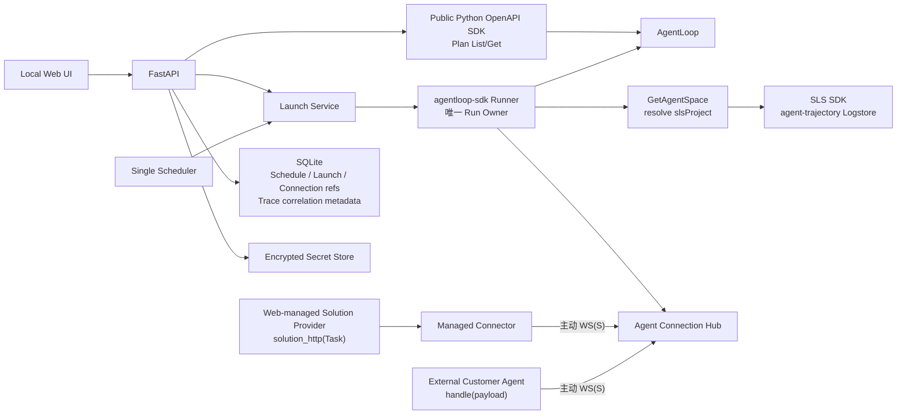

# AgentLoop Local Experiment Launcher 产品与技术规格

> 文档版本：v1.0
> 日期：2026-08-08
> 状态：冻结需求与当前实现对齐稿
> 项目目录：`agentloop-local-experiment-launcher/`
> SDK 基线：`alibabacloud-agentloop20260520==2.3.1`、`agentloop-sdk==1.0.3`

## 1. 产品结论

AgentLoop 是云端实验管理与结果平台，但不能直接访问客户内网 Agent。本项目部署在客户环境，承担“读取云端已有实验计划，并在客户侧真实运行一次或周期运行实验”的最小闭环。

标准流程：

```text
AgentLoop 创建 OFFLINE Experiment Plan
  → 本地平台 List/Get Plan
  → 配置单题 Solution Provider，或由外部 Agent 主动 WebSocket 连接
  → 操作者选择 Plan + Agent + 版本 + JSON 参数
  → 人工 Launch 或 Schedule 触发
  → 按 Plan ID 创建或更新唯一云端评估大盘并回读验证
  → 客户侧 Runner 遍历 Plan Dataset 并调用本地 Agent
  → Runner 创建唯一 Experiment Run、上传结果
  → 本地 Launch History 保存 recordId/时间/配置快照
  → 用户跳转 AgentLoop 查看 Record 或当前 Plan 的跨 Run 评估大盘
```

### 1.1 强制边界

1. Experiment Plan、Dataset、Evaluator 只能在 AgentLoop 创建和维护。
2. 本地对 Plan 只提供 List/Get，不提供 Create/Update/Delete。
3. 本地核心写能力只有：人工 Launch、Schedule、Agent Connection 和部署连接配置。
4. 人工和周期 Launch 都必须指定本地 Agent Connection、`MANUAL/AUTO` 版本策略和 JSON 参数。
5. 本地只展示 Launch History；不展示 Record 列表/详情、状态、分数、Trace、样本结果或报告。
6. 每条结果只通过 `recordId` 深链到 AgentLoop 查看。
7. Agent 必须主动连接本地平台；平台不要求云端或平台主动穿透客户 Agent 网络。
8. 离线 Runner 是唯一 Record Owner；控制面不得先创建第二个 Run。
9. AK/SK、Agent Token 不得明文进入 SQLite、HTTP 读取响应、日志或 Trace。
10. Fake 只用于开发测试，不能作为真实实验验收。
11. Web 工作台源码只定义单个 Dataset item 的 Solution Provider；Plan/Dataset/Run、并发、
    版本/XML context、上传和评估始终由外层平台控制。
12. Dashboard 以 Experiment Plan 为唯一业务边界；不得按 Launch、Run 或版本创建大盘。

本文中的 MUST、SHOULD、MAY 分别表示强制、默认应实现和可选扩展。

## 2. 目标与非目标

### 2.1 目标

| 编号 | 目标 |
|---|---|
| G-01 | 用配置的 AK/SK、Region、AgentSpace 分页读取所有可见 Plan，并按 Plan ID 选择 |
| G-02 | 注册本地 Agent，安全建立由 Agent 发起的 WebSocket 长连接 |
| G-03 | 用户可人工发起一次真实离线实验 |
| G-04 | 用户可配置每 N 分钟（最小 5 分钟）或每天固定时间自动发起 |
| G-05 | 每次 Launch 固化 Agent、最终版本、参数、Plan 和 context |
| G-06 | 准确保存触发时间、提交/Runner 状态和 AgentLoop `recordId` |
| G-07 | 用户从 Launch History 跳转到 AgentLoop 查看结果 |
| G-08 | 防止双击、HTTP 重试、重复调度 tick 造成同一本地意图重复启动 |
| G-09 | 每个 Experiment Plan 幂等维护一个云端大盘，在同一 Plan 内比较多个 Run/版本/题目 |

### 2.2 非目标

- 本地 Plan/Dataset/Evaluator/Candidate/Prompt 管理。
- 本地创建、查询、缓存或重新计算评估结果。
- 本地 Record 页面、评估结果副本、图表渲染和报告；图表由本地平台在云端 SLS 创建并跳转查看。
- 远端 Run 的取消、重跑、删除、Promote 或 Deploy。
- 通用工作流、数据处理平台或任意 Cron 编排器。
- 多租户、本地用户系统和 RBAC。
- 多节点高可用调度；MVP 为单机、单 SQLite、单 active scheduler。

## 3. 前置条件与权限

### 3.1 云端资源

- 已在 AgentLoop 创建 `OFFLINE` Experiment Plan。
- Plan 已绑定非空 Dataset；Dataset 至少有一条可执行问题。
- Plan 至少绑定一个 Evaluator，Evaluator 必需变量映射完整。
- 若 Evaluator 需要版本等自定义字段，应从 Runner 上传的 `experiment_input`/context 中提取；本地 UI 不编辑 Evaluator。

### 3.2 网络与运行环境

- 客户主机能访问 `agentloop.<region>.aliyuncs.com` 或配置的 Endpoint。
- 本地 Agent 能访问 Launcher 的 WS/WSS 地址。
- 打包版运行时不依赖宿主机 Python、Node.js、npm 或 uv；原生包按 OS/CPU 架构分别构建。
- 源码开发使用 Python 3.12；后端依赖按 `backend/uv.lock` 锁定，前端依赖按
  `frontend/package-lock.json` 锁定。
- 正式服务器的 Secret Store Master Key 由部署系统注入；本机单用户模式允许首次启动
  在稳定应用数据目录生成权限为 `0600` 的 Key。

### 3.3 最小云端权限

运行身份应仅获得真实 Runner 必需权限：

- Get AgentSpace；
- List/Get Experiment Plan；
- 读取 Plan 关联 Dataset；
- 创建/更新 Experiment Run；
- 上传离线实验结果及触发 Plan 绑定 Evaluator 所需权限。
- 读取 AgentSpace 绑定的 SLS Project，并 Get/Create/Update Dashboard；MVP 不需要 Delete Dashboard。

本地业务不需要 Plan、Dataset、Evaluator 的写权限，也不需要删除 Run 的权限。

## 4. 核心概念

### 4.1 Experiment Plan

AgentLoop 的云端事实源，包含 Dataset 和 Evaluator 绑定。本地 Schedule 始终绑定 `planId`，不能绑定可重名的 Plan Name。

### 4.2 Agent Connection

一个本地 Agent 注册和活跃 WebSocket 会话：

- 注册元数据和 Token Secret 引用保存在本地。
- Token 只在创建/轮换时展示一次，Secret 本体进入 Secret Store。
- Agent 用 Bearer Token 主动连接平台。
- 活跃会话只存在内存，进程重启后 Agent 自动重连。
- 一个 Connection 同时只允许一个在线 WebSocket。

Connection 可由两种执行适配器占用：

- Web 工作台保存并启动的受管 Solution Provider，用户入口为
  `solution_http(Task) -> SolutionOutput`；
- 客户独立进程中的外部 Connector，用户入口为 `handle(payload)`。

二者共享 WebSocket 传输层，但用户代码契约不同。

### 4.3 Launch Intent

本地不可变启动账本。它回答：谁在何时用哪个 Plan、Agent、版本和参数发起，以及是否取得权威 `recordId`。它不是实验结果。

### 4.4 Schedule

本地周期规则，绑定 Plan ID、Agent Connection 和执行配置。每次触发创建一个独立 Launch，并重新读取当前云端 Plan。

### 4.5 Experiment Run / Record

AgentLoop 云端权威实验记录。由本地 Runner 内的 `agentloop-sdk` 创建一次。`recordId` 只保存为 Launch 的云端关联键和深链参数；本地不提供 Record 数据页。

### 4.6 Plan Dashboard

AgentSpace 绑定 SLS Project 中的云端资源。一个 Experiment Plan 对应一个稳定
`dashboardName`，一个 Plan 下的 N 个 Experiment Run 共用该大盘。Plan Name 可变，只作为显示名；
Plan ID 才是查询和本地关联键。本地只保存同步状态、模板版本、SLS Project 和大盘名，不保存评分数据。

## 5. 信息架构

本地 Web UI 有五个页面：

### 5.1 Agent Connections

展示 Connection 名称、ID、连接/健康状态、最近心跳和创建时间。支持：

- 通过“平台托管代码”或“外部 Agent 主动连接”两种模式创建 Connection；
- 平台托管模式创建后 MUST 直接进入代码工作台，Token 由平台内部管理；
- 外部 Agent 模式当次展示并复制 Token、Connect URL 和参考命令；
- 轮换 Token；
- 删除 Connection；
- 查看在线状态；
- 从内置样例编辑单题 Solution Provider，并通过一个主操作完成保存、启动和合成 `Task` 测试。

Web 工作台不得要求或引导用户粘贴完整实验脚本。Dataset 在云端 Plan 外层绑定；Plan
选择、Dataset 遍历、Run 创建、并发、版本/XML context 和 Evaluator 均不在此页面配置。

删除或轮换 Token 会断开当前连接，但不删除历史 Launch。

### 5.2 Plans

Plan 列表实时来自 AgentLoop。展示 Plan ID/Name、类型、云端返回状态（仅展示）、Dataset、Evaluator 数量和不可运行原因。Plan 状态不得作为本地发起门禁；是否接受一次执行以 `CreateExperimentRun` 的响应为准。支持搜索、分页、刷新、人工 Launch 和创建 Schedule。

人工 Launch 确认框必须可配置：

- 在线 Agent Connection；
- `MANUAL` 或 `AUTO` 版本；
- MANUAL 版本号；
- JSON object 参数；
- 可选 Record Name。

不得在此编辑 Dataset、Evaluator 或云端 Plan 元信息。

### 5.3 Schedules

展示 Schedule、Plan、Agent、版本策略、频率、时区、上/下次触发和最近错误。支持创建、编辑、启用、暂停、软删除和 Run Now。

### 5.4 Launch History

只展示本地启动账本：

- Launch ID、Plan ID/Name 快照；
- Agent Connection ID/Name 快照；
- 版本模式与最终版本；
- JSON 参数；
- `manual/schedule/schedule_run_now`；
- Submission/Runner 状态；
- 计划、请求、接受和完成时间；
- `recordId`、脱敏错误和 AgentLoop 深链。
- 当前 Plan 大盘的 `PENDING/READY/FAILED` 状态、最后同步时间、脱敏错误码和深链。

页面必须提示：它不是评估结果页。分数、Trace、样本详情和报告仍在 AgentLoop/SLS 大盘查看；
同一 Plan 的所有 Launch 显示同一个大盘名。

### 5.5 Settings

管理一个活动 Profile：Region、AgentSpace、API Endpoint、Console Base URL、AK/SK、默认时区和本地并发上限。保存后不回显 Secret，只显示 AK 脱敏提示；Test Connection 只读验证 AgentSpace。

## 6. 功能需求

### 6.1 AgentLoop 配置

| 编号 | 需求 |
|---|---|
| FR-CONF-001 | MUST 支持一个活动 Region + AgentSpace + AK/SK Profile |
| FR-CONF-002 | MUST 使用公开 Python SDK，不在生产路径 shell 调用 `aliyun` |
| FR-CONF-003 | MUST 提供 Test Connection；失败后阻止 Plan 访问和 Launch |
| FR-CONF-004 | MUST 不在任何读取 API 回显 AK/SK |
| FR-CONF-005 | 凭据轮换 MUST 不改变 Schedule 的 Plan/Agent 绑定 |

### 6.2 Plan

| 编号 | 需求 |
|---|---|
| FR-PLAN-001 | MUST 分页处理 AgentLoop `nextToken`，并按本地 offset/limit 返回 |
| FR-PLAN-002 | MUST 用 Plan ID 作为关联键 |
| FR-PLAN-003 | MUST 不存在 Plan 写入口和写 API |
| FR-PLAN-004 | 每次 Launch 前 MUST 重新 Get Plan |
| FR-PLAN-005 | 非 OFFLINE、无 Dataset、无 Evaluator、变量映射缺失时 MUST 禁止 Launch |
| FR-PLAN-006 | Plan 删除/停用/变更后 MUST Fail Closed，不得使用旧快照执行 |

### 6.2.1 Plan Dashboard

| 编号 | 需求 |
|---|---|
| FR-DASH-001 | MUST 以 AgentSpace + Plan ID 派生稳定 dashboardName，不得包含 Run ID、Launch ID 或版本 |
| FR-DASH-002 | 每次通过启动前校验的人工、Run Now 或周期 Launch MUST 对同一资源执行 Get→Update，404 时 Create，并最终 Get 回读 |
| FR-DASH-003 | 每条 `evaluation_detail` 查询 MUST 固定目标 Plan ID，不得只依赖可清除的 Plan 下拉筛选 |
| FR-DASH-004 | MUST 不提供 Plan 选择器；SHOULD 提供 Run、实验版本、题目、Evaluator、Evaluator 版本、Rubric 与趋势粒度筛选 |
| FR-DASH-005 | Plan 改名 MUST 更新显示名但不得创建第二个大盘 |
| FR-DASH-006 | 大盘同步失败 MUST 单独记录且不得阻断 Experiment Run；下次该 Plan Launch MUST 重试 |
| FR-DASH-007 | MUST 拒绝覆盖 managedBy、AgentSpace 或 Plan ID 不匹配的同名资源 |
| FR-DASH-008 | 顶部筛选器 MUST 使用紧凑单行布局，不得用空白文本组件占据首屏 |
| FR-DASH-009 | MUST 提供按题目 ID 分类的分数趋势，每个题目为独立序列，并按统一 Run 时间对齐 |
| FR-DASH-010 | MUST 提供按题目聚合的平均分横向柱状图，默认低分优先，失败记录不得按 0 分混入均值 |

### 6.3 Agent Connection

| 编号 | 需求 |
|---|---|
| FR-AGENT-001 | Agent MUST 主动连接 `/agent-connections/{id}/connect` |
| FR-AGENT-002 | WebSocket MUST 使用 Bearer Token 认证 |
| FR-AGENT-003 | Token MUST 只在创建/轮换响应展示一次 |
| FR-AGENT-004 | 人工 Launch 时 Agent MUST 当前在线 |
| FR-AGENT-005 | Schedule MUST 绑定 Agent；触发时 Agent 离线则不得启动 Runner |
| FR-AGENT-006 | 单题超时、Agent error、Socket 断开 MUST 成为明确 Runner 失败，不得伪装成功 |
| FR-AGENT-007 | Web 工作台代码 MUST 以 `Task` 为单题输入并返回 `SolutionOutput` |
| FR-AGENT-008 | Web 工作台 MUST NOT 要求 `AgentLoopConfig`、`run_experiment_parallel`、`main` 或 Dataset/Plan 配置 |
| FR-AGENT-009 | 外部 Connector MUST 继续支持 `handle(payload)`，并与 Web Solution Provider 契约明确区分 |
| FR-AGENT-010 | 新建 Agent MUST 默认选择平台托管代码，且该流程 MUST NOT 要求用户复制 Token |
| FR-AGENT-011 | 工作台 MUST 提供 Session HTTP、单接口 HTTP 和 Echo 样例供用户选择并修改 |
| FR-AGENT-012 | 主操作 MUST 一次完成保存、启动和测试，并明确展示 Agent 返回结果 |
| FR-AGENT-013 | 已验证启用的托管代码 MUST 在 Launcher 重启后自动恢复；仅保存的 revision MUST NOT 自动启动 |

### 6.4 Launch 配置

| 编号 | 需求 |
|---|---|
| FR-LAUNCH-001 | 人工与 Schedule MUST 共用同一 Launch Service |
| FR-LAUNCH-002 | MUST 固化 Agent、版本、参数、Record Name、context schema 和 hash |
| FR-LAUNCH-003 | MANUAL MUST 提供合法版本；AUTO MUST 不接收人工版本 |
| FR-LAUNCH-004 | AUTO MUST 每个 Launch 只生成一次，并在所有 item 复用 |
| FR-LAUNCH-005 | 参数 MUST 是合法 JSON object，不接受数组/null/NaN |
| FR-LAUNCH-006 | 浏览器 MUST 为人工/Run Now 请求生成稳定 `Idempotency-Key` |
| FR-LAUNCH-007 | 相同 Key 携带不同配置 MUST 返回冲突 |
| FR-LAUNCH-008 | `recordId` MUST 来自 Runner callback，禁止本地生成 |

### 6.5 Schedule

| 编号 | 需求 |
|---|---|
| FR-SCHED-001 | MUST 支持每 N 分钟（最小 5 分钟）和每天固定时间；已有小时任务继续兼容 |
| FR-SCHED-002 | Daily MUST 使用 IANA 时区 |
| FR-SCHED-003 | 修改 MUST 增加 revision，只影响未来 Slot |
| FR-SCHED-004 | Slot MUST 有稳定唯一键，重复 tick 不得重复执行 |
| FR-SCHED-005 | MUST 支持 `SKIP` 和 `FIRE_ONCE` Misfire |
| FR-SCHED-006 | 同 Schedule 本地 Runner 仍在运行时，下一 Slot MUST 跳过 |
| FR-SCHED-007 | 失败 Slot MUST 推进 `next_fire_at`，不能每次 poll 重复触发 |
| FR-SCHED-008 | 暂停/删除 MUST 不取消已启动 Run，不删除 Launch History |

### 6.6 结果跳转

| 编号 | 需求 |
|---|---|
| FR-LINK-001 | 获得 `recordId` 后 MUST 生成 AgentLoop 深链或明确显示链接不可用 |
| FR-LINK-002 | 深链 MUST 使用当前 Region、AgentSpace、Plan ID 和 Record ID |
| FR-LINK-003 | 前端 MUST 使用新标签、`noopener,noreferrer` 和安全 URL 校验 |
| FR-LINK-004 | 本地 MUST 不提供 Record/分数/Trace/样本结果 API 或 UI |

## 7. 版本、参数与 Context

### 7.1 版本策略

MANUAL 版本格式：

```regex
^[A-Za-z0-9][A-Za-z0-9._-]{0,127}$
```

AUTO 版本：

```text
auto-<UTC YYYYMMDDTHHMMSSffffffZ>-<launch-id 前 12 个字母数字>
```

版本是 Launch 不可变快照。幂等重试不会重新生成版本；新的 Schedule Slot 会创建新的 Launch 和 AUTO 版本。

### 7.2 参数

`experimentParameters` 必须是 JSON object。平台规范化 Key 顺序后保存；同一对象的不同文本排版得到相同稳定表示。参数同时：

- 作为 Launch/Schedule 快照持久化；
- 传入本地 Agent payload 的 `parameters`；
- 写入 Runner 的 Experiment metadata。

### 7.3 五字段 XML Context

原始用户问题不被替换，Runner 在末尾追加：

```xml
<experiment_context schema_version="1">
  <experiment_plan_id>plan-id</experiment_plan_id>
  <experiment_run_id>record-id</experiment_run_id>
  <experiment_version>resolved-version</experiment_version>
  <dataset_item_id>item-id</dataset_item_id>
  <local_launch_id>launch-id</local_launch_id>
</experiment_context>
```

五个子字段全部必填、不能增加未知字段。所有值使用 XML Serializer 转义。Runner 还把同样内容作为结构化 `context` 传给 Agent，并在 `SolutionOutput.meta` 保留 `experiment_input` 和 `experiment_context`，供云端 Evaluator 提取。

## 8. Agent 执行适配与主动连接协议

### 8.1 Web Solution Provider 契约

工作台源码是 Runner 的单题执行适配器，规范入口为：

```python
async def solution_http(task: Task, *args, **kwargs) -> SolutionOutput:
    ...
```

外层 Runner MUST 根据当前 Dataset item 构造 `Task`，并负责 Dataset 遍历、并发控制、版本
解析、XML context 注入、唯一 Run 创建、结果上传和 Evaluator 触发。工作台源码 MUST 只调用
一次客户 Agent 并返回当前题目的 `SolutionOutput`；它不是完整实验脚本。

工作台的“单题测试”使用合成 `Task` 验证入口、返回值和本地链路，不得声称已运行 Plan、
Dataset 或云端 Evaluator。

### 8.2 外部 Connector 握手

外部客户 Agent 作为独立进程实现 `handle(payload)`，并主动建立以下连接。此
`handle(payload)` 是 WebSocket 传输适配器，不是第 8.1 节 Web 工作台源码的入口。

```text
Agent → WS(S) /api/v1/agent-connections/{connectionId}/connect
        Authorization: Bearer <token>
Server → {"type":"registered","agentConnectionId":"...","protocolVersion":1}
Agent  → {"type":"ready"}
```

### 8.3 外部 Connector 任务

Server 发送外层 envelope：

```json
{
  "type": "task",
  "taskId": "<transport task id>",
  "payload": {
    "type": "experiment.task",
    "requestId": "<dataset task id>",
    "input": "<question + XML>",
    "originalInput": {},
    "sdkTask": {
      "id": "<dataset task id>",
      "input": {},
      "groundTruth": null,
      "tags": [],
      "metadata": {}
    },
    "context": {},
    "parameters": {}
  }
}
```

Agent 必须回传相同 transport `taskId`：

```json
{"type":"result","taskId":"...","success":true,"output":"...","trajectory":[],"meta":{"traceId":"..."}}
```

或：

```json
{"type":"error","taskId":"...","error":"sanitized error"}
```

完整集成说明见 [docs/LOCAL_AGENT_INTEGRATION.md](./docs/LOCAL_AGENT_INTEGRATION.md)。

## 9. 运行架构与 Record 所有权



Runner-owned 顺序：

1. Launch Service 用 OpenAPI SDK Get 最新 Plan。
2. 建立本地 `LaunchIntent`，状态进入 `SUBMITTING/RUNNING`。
3. `agentloop-sdk` 解析 Plan/Dataset 并创建唯一 Experiment Run。
4. Runner 立即 callback `recordId`，本地保存为 `ACCEPTED`。
5. Runner 遍历 Dataset，通过指定 Connection 调用 Agent，并记录调用时间窗。
6. Runner 先调用 `GetAgentSpace` 解析当前 AgentSpace 的 `slsProject`，再用
   `aliyun-log-python-sdk` 查询该 Project 固定的 `agent-trajectory` Logstore；不使用 XTrace 或
   `ListTracePreview`。以 XML 根 `experiment_context` 加 Plan/Run/Item/Launch 四字段轮询：先查
   Agent hint 的 `trace_id`，再查 `input` 五项、日志全文五项，最后在字段未被索引时以固定时间窗
   `*` 扫描，每页 100 条、最多 5 页。只在内存解析 `input`/`atif_content` XML；每页必须
   `Complete`、`isAccurate=true` 且非 limited。Agent 返回的 `traceId` 也必须先验证；歧义、响应
   不完整、扫描上限或错误均失败关闭，轨迹 payload 不得持久化或写入日志。四种关联来源为
   `agent_trajectory_trace_id`、`agent_trajectory_input_context`、
   `agent_trajectory_line_context`、`agent_trajectory_scan_context`。
   Agent 完成后的轨迹轮询默认持续 180 秒；部署可通过
   `AGENTLOOP_LAUNCHER_TRACE_LOOKUP_TIMEOUT_SECONDS` 配置 61–1800 秒，且修改后重启生效。
7. 只有唯一 Trace 可见时，Runner 才把 `traceId` 放入 `SolutionOutput.meta`，并向
   `experiment_detail` 一次性写入该题。禁止先写无 ID detail 后再补写。
8. 所有 item 的 detail 均成功上报后，Runner 才把 Experiment Run 更新为 `completed`；
   云端随后触发 Plan 绑定的 Evaluator。
9. 任一 item 歧义、超时、权限失败或上传失败时，Run 不得误报 completed。

Control SDK 不执行步骤 3。一个组件创建 Run、另一个组件再创建 Run 是禁止架构。

## 10. 状态模型

Submission 状态：

```text
CREATED → SUBMITTING → ACCEPTED
                    ├→ DEFINITIVE_FAILURE
                    └→ SUBMISSION_UNKNOWN
Schedule 还可产生 SKIPPED
```

Runner 状态：

```text
NOT_STARTED → RUNNING → HANDED_OFF
                      ├→ FAILED
                      └→ UNKNOWN
```

- `ACCEPTED`：已保存权威 `recordId`，不表示运行/评估完成。
- `HANDED_OFF`：客户侧 Runner 已完成本地执行和上报职责，不表示分数达标。
- `SUBMISSION_UNKNOWN`：可能已创建远端 Run但无法确认；相同本地 Key 不自动重试。
- `FAILED`：Run 已创建后本地 Agent 或上报确定失败。
- `UNKNOWN`：进程中断等无法确定的本地 Runner 终态。

Trace 关联状态：

```text
PENDING → POLLING → RESOLVED → REPORTED
                  ├→ AMBIGUOUS
                  ├→ TIMED_OUT
                  └→ FAILED
```

完整查询键、轮询、一次性上报和恢复契约见
[docs/TRACE_CORRELATION.md](./docs/TRACE_CORRELATION.md)。

本地不读取或映射云端评估状态作为产品状态。

## 11. 本地 API

```text
GET    /api/v1/health

GET    /api/v1/settings/agentloop
PUT    /api/v1/settings/agentloop
POST   /api/v1/settings/agentloop/test

POST   /api/v1/agent-connections
GET    /api/v1/agent-connections
GET    /api/v1/agent-connections/{id}
GET    /api/v1/agent-connections/{id}/health
POST   /api/v1/agent-connections/{id}/rotate-token
DELETE /api/v1/agent-connections/{id}
WS     /api/v1/agent-connections/{id}/connect

GET    /api/v1/plans
GET    /api/v1/plans/{planId}
POST   /api/v1/plans/{planId}/launch

GET    /api/v1/launches
GET    /api/v1/launches/{launchId}

GET    /api/v1/schedules
POST   /api/v1/schedules
GET    /api/v1/schedules/{id}
PATCH  /api/v1/schedules/{id}?expectedRevision=N
DELETE /api/v1/schedules/{id}?expectedRevision=N
POST   /api/v1/schedules/{id}/run-now
POST   /api/v1/schedules/{id}/enable?expectedRevision=N
POST   /api/v1/schedules/{id}/disable?expectedRevision=N
```

明确不存在的产品 API：

```text
POST/PATCH/DELETE /api/v1/plans
POST/PATCH/DELETE /api/v1/datasets
POST/PATCH/DELETE /api/v1/evaluators
GET /api/v1/experiment-records
GET /api/v1/experiment-records/{recordId}
GET /api/v1/.../results
```

### 11.1 人工 Launch

```http
POST /api/v1/plans/{planId}/launch
Idempotency-Key: <stable browser request id>
Content-Type: application/json
```

```json
{
  "agentConnectionId": "<connection-id>",
  "versionMode": "MANUAL",
  "experimentVersion": "1.2.3",
  "experimentParameters": {
    "temperature": 0.2
  },
  "recordName": null,
  "contextSchemaVersion": 1
}
```

`202 Accepted` 响应返回 Launch 快照、`submissionState`、`runnerState`、最终版本、`recordId`、
`agentLoopUrl` 和无载荷 `traceCorrelation` 汇总。它不返回实验结果或 Trace body。

### 11.2 Schedule

Interval 示例：

```json
{
  "name": "hourly-regression",
  "planId": "<plan-id>",
  "agentConnectionId": "<connection-id>",
  "versionMode": "AUTO",
  "experimentParameters": {},
  "contextSchemaVersion": 1,
  "cadence": {
    "type": "INTERVAL_MINUTES",
    "intervalMinutes": 5,
    "anchorAt": "2026-08-08T09:00:00+08:00"
  },
  "timezone": "Asia/Singapore",
  "misfirePolicy": "FIRE_ONCE",
  "enabled": true
}
```

Daily 把 cadence 改为：

```json
{"type":"DAILY","time":"09:00"}
```

## 12. 本地数据归属

| 数据 | 权威位置 | 本地行为 |
|---|---|---|
| Plan/Dataset/Evaluator | AgentLoop | Plan 实时 List/Get；Dataset 仅 Runner 临时遍历；不建业务副本 |
| Experiment Run/结果/分数/Trace | AgentLoop | 保存 `recordId` 与无载荷 Trace 关联状态；不缓存题目、回答、Trace body、trajectory 或结果 |
| Schedule | SQLite | 本地事实源 |
| Launch Intent / Trace Correlation | SQLite | 本地事实源；Trace 表仅含 ID、状态、次数、时间与脱敏错误 |
| Plan Dashboard | SLS（AgentSpace 绑定 Project） | 云端唯一资源；SQLite 仅保存 Plan 级同步元数据和安全错误码 |
| Agent Connection 注册 | SQLite | 只保存注册、时间和 Token Secret 引用；在线会话在内存 |
| Region/AgentSpace 等部署配置 | SQLite | 非敏感 Profile 元数据和 Secret 引用 |
| AK/SK、Agent Token | Secret Store | SQLite 只保留引用和脱敏提示 |
| Runner 临时结果 | 权限受限目录 | 仅 SDK 执行/上传使用，不作为产品查询源 |

SQLite MUST 启用 WAL、Foreign Keys 和 `busy_timeout=5000`。数据目录 `0700`，数据库/sidecar/Secret 文件 `0600`。Schema 使用版本表和可审计迁移；v1→v2 增加 Agent Connection 与 Launch 配置快照，v2→v3 增加无载荷 Trace 关联审计表，v3→v4 增加分钟级 Schedule，v4→v5 增加无评分载荷的 Plan Dashboard 同步表。

禁止为 Plan、Dataset、Evaluator、Record、Score、Trace body 或 Case Result 建本地业务副本；
`trace_correlations` 只能保存关联元数据，不能保存 input/output/trajectory。

## 13. 幂等、调度与恢复

本地幂等键：

```text
manual:{browser-request-id}
schedule:{schedule-id}:{revision}:{slot-utc}
schedule-run-now:{schedule-id}:{browser-request-id}
```

这些 Key 不传给 AgentLoop，不等同远端 `clientToken`。

- 同 Key + 同配置返回原 Launch；同 Key + 不同 Plan/配置返回 `IDEMPOTENCY_KEY_CONFLICT`。
- 同 Schedule 的 `runner_state=RUNNING` 时新 Slot 记为 Overlap Skip。
- `FIRE_ONCE` 最多补最近一个仍在 Grace Window 的 Slot；`SKIP` 跳过历史错过 Slot，
  但必须执行在 Scheduler 两次 poll 容差内观测到的当前 Slot，不能导致任务永不运行。
- 编辑/启停/删除使用 `expectedRevision` 做并发控制。
- 进程重启后，有 `recordId` 的 Launch 保持 `ACCEPTED`；遗留 Runner `RUNNING` 转 `UNKNOWN/INTERRUPTED`。
- 遗留 Trace PENDING/POLLING/RESOLVED 转为 `FAILED/LOCAL_PROCESS_INTERRUPTED`；因本地不保存
  Agent 输出，不自动补写或重复上报。
- 不按 `clientToken` Resume/Reconcile，不自动重试结果未知的旧 Launch；未来独立 Slot不被永久阻塞。

## 14. 安全

### 14.1 Secret

- 正式服务器模式必须通过 `AGENTLOOP_LAUNCHER_MASTER_KEY` 注入外部管理的 Key。
- 本机单用户一键启动 MAY 原子生成本地 `master.key`，权限必须为 `0600`；如果
  `secrets.enc` 已存在但 Key 缺失，MUST 拒绝生成新 Key并 Fail Closed。
- 受控单机私网部署 MAY 通过显式 `--use-local-master-key` 强制复用上述本地 Key；该模式优先于继承的环境变量，不得被描述为等价于 Secret Manager，也不得生成新 Key 覆盖遗失的旧 Key。
- Secret 写入后不可通过 GET 回读。
- Agent Token 只在创建/轮换响应展示一次；轮换使旧 Token 失效并断开旧 Session。
- 禁止在日志、错误、Trace、Launch 参数和深链中携带凭据。

### 14.2 Web

- 默认绑定 `127.0.0.1`。
- Development 模式拒绝非 Loopback 请求，并校验写请求 Origin。
- 非 Loopback 监听必须显式开启 `allow_remote_access`，并同时使用 Production 模式以及外部注入的 Master Key 或显式 `--use-local-master-key` 单机模式；任一条件缺失都必须 Fail Closed。
- 暴露到局域网/公网前，部署方必须在前置代理完成 TLS、VPN/SSO、访问控制和必要的 CSRF 会话防护。
- 本项目不内置生产用户认证；`environment=production` 不是自动安全边界。

### 14.3 日志

允许记录 Launch/Plan/Record/Schedule/Connection ID、状态和脱敏错误；禁止记录 AK/SK、Bearer Token、Dataset 内容、Agent input/output、Trace 和评估结果。

### 14.4 发布包

- MUST 将构建后的 React 页面由同一个 FastAPI 进程和端口托管。
- MUST 仅对浏览器页面路由做 SPA fallback；`/api/v1/*` 和不存在的 `/assets/*` 保持 404。
- MUST 默认真实 `agentloop` Gateway、开启 Scheduler并监听 Loopback；受控部署只有在显式满足非 Loopback 三重门禁时才可改变监听地址。
- MUST 使用白名单 staging，拒绝 `.env`、Master Key、SQLite、加密 Secret、source map 和
  Python 缓存进入包。
- Reference Agent 命令不得包含一次性 Token；Token 应从安全提示、环境或 Secret Manager读取。
- 面向 macOS 客户正式外发的包 MUST 使用 Developer ID 签名并通过 Apple notarization；
  ad-hoc 签名包只能作为内部验收产物，不得宣称可直接外发。

## 15. 错误边界

| 错误码 | 含义 |
|---|---|
| `CONNECTION_NOT_CONFIGURED` | 未配置 AgentLoop Profile |
| `CONNECTION_NOT_VALIDATED` | 尚未通过 Test Connection |
| `AGENTLOOP_AUTH_FAILED` | AK/SK 无效或权限不足 |
| `AGENTLOOP_UNAVAILABLE` | 云端不可达 |
| `PLAN_NOT_FOUND` | Plan 不存在 |
| `PLAN_NOT_RUNNABLE` | Plan 类型、Dataset、Evaluator 或映射不满足条件 |
| `AGENT_CONNECTION_REQUIRED` | 未选择 Agent |
| `AGENT_CONNECTION_NOT_FOUND` | Agent Connection 不存在 |
| `AGENT_CONNECTION_OFFLINE` | Agent 未在线 |
| `IDEMPOTENCY_KEY_CONFLICT` | 同一本地 Key 对应不同配置 |
| `LOCAL_CONCURRENCY_LIMIT` | 本地 Runner 达到并发上限 |
| `SUBMISSION_UNKNOWN` | 无法判断远端是否已创建 Run |
| `SCHEDULE_REVISION_CONFLICT` | Schedule 被并发修改 |
| `TRACE_AMBIGUOUS` | 同一实验题匹配到多个 Trace ID |
| `TRACE_LOOKUP_TIMED_OUT` | 截止时间内没有唯一 Trace 可见 |
| `TRACE_SEARCH_PERMISSION_DENIED` | AK 无权读取 AgentSpace 绑定 Project 的 `agent-trajectory` |
| `TRACE_SOURCE_NOT_FOUND` | `GetAgentSpace.slsProject` 或其 `agent-trajectory` 不存在 |
| `TRACE_SEARCH_UNAVAILABLE` / `TRACE_SEARCH_REJECTED` | SLS 暂不可用可重试 / SLS 拒绝请求不可继续 |
| `TRACE_SEARCH_DEADLINE_EXCEEDED` | 单次 SLS 查询已超过轮询剩余时间 |
| `TRAJECTORY_QUERY_INCOMPLETE` | SLS 页未完成或 `isAccurate!=true`，可重试 |
| `TRAJECTORY_QUERY_LIMITED` | SLS 页为 limited，拒绝从截断候选选择 |
| `TRAJECTORY_QUERY_INCONSISTENT` | 字段查询与固定窗口扫描结果不一致，可重试 |
| `TRAJECTORY_INVALID_RESPONSE` | `agent-trajectory` 响应不符合安全解析条件 |
| `TRAJECTORY_SCAN_LIMIT_EXCEEDED` | 固定窗口达到 5 页 × 100 条边界，拒绝从不完整候选选择 |
| `TRAJECTORY_PAYLOAD_LIMIT_EXCEEDED` | 轨迹超过安全内存解析边界 |
| `TRAJECTORY_TRACE_ID_INVALID` | 匹配 XML 的轨迹没有合法 Trace ID |
| `TRACE_ID_INVALID` / `TRACE_HINT_MISMATCH` | Agent hint 非法 / 与 SLS 验证结果不一致 |

错误内容必须脱敏；不能把 SDK Request/Response、Agent input/output 或 Secret 原样透出。

## 16. 可观测性与黄金指标

本项目黄金指标：

```text
Launch-to-Record 关联成功率 =
获得唯一权威 recordId 且本地持久化成功的 Launch 数
÷
通过启动前校验并进入 SUBMITTING 的 Launch 数
```

护栏：

- 一个逻辑 Launch 对应多个 Record 的数量必须为 0。
- Schedule 同一 Slot 重复启动数必须为 0。
- `SUBMISSION_UNKNOWN` 必须单独可见，不归入成功/明确失败。
- Secret 在 SQLite/WAL/日志/HTTP 响应中的检出数必须为 0。
- 本地 Agent 收到题目的数量应与 Runner 实际选择的 Dataset item 数一致。
- 无 `traceId` 的 experiment detail 数必须为 0；同一 task 重复 detail 数必须为 0。
- Trace 关联成功率 = `REPORTED item / 已调用 Agent item`，未达 100% 时 Run 不得 completed。

该指标只衡量发起平台可靠性。Agent 效果与评估质量必须在 AgentLoop 结果中判断。

## 17. 测试与验收

### 17.1 自动化测试

```bash
uv run --project backend pytest
uv run --project backend ruff check backend/app backend/tests
cd frontend && npm test && npm run typecheck && npm run build
```

测试必须覆盖：

- Plan 分页、Get、不可运行原因和 SDK 错误脱敏；
- Agent token 创建/轮换/删除、WS 认证、在线/离线和断开；
- MANUAL/AUTO、JSON 参数、XML 转义、五字段完整性；
- 人工幂等、Schedule Slot、revision、Misfire、Overlap 和失败后推进；
- Runner-owned callback、单一 Record、上传失败不得误报成功；
- `GetAgentSpace.slsProject` 与固定 `agent-trajectory` source 校验、Trace 延迟可见、hint 验证、
  无 hint 的 XML 根 + 四字段反查、`input`/全文未索引时 100 条分页与 5 页上限、每页
  Complete/accurate/non-limited 校验、歧义/超时/权限失败以及所有 detail 上报后的 Experiment
  completion barrier；
- SQLite Migration、权限和 Secret 不泄漏；
- 原生包在脱离源码目录的临时目录中可执行 doctor、启动、深链刷新、配置持久化和重启恢复；
- 前端只显示 Launch History，不显示 Record/结果页。

### 17.2 真实云端验收

Mock/Fake、HTTP 200、进程运行或本地单测均不足以验收。一次验收必须使用：

1. 真实 AgentSpace 中的 OFFLINE Plan；
2. 真实 Dataset，至少一条能由接入 Agent 回答的问题；
3. 真实绑定 Evaluator，且能评分并从 context 提取版本等自定义字段；
4. `gateway_mode=agentloop`；
5. 真实在线 Agent Connection，且 Agent 会向目标 AgentSpace 导出带关联字段的入口 Trace；
6. 人工 Launch 的指定 Agent、MANUAL/AUTO 版本和 JSON 参数；
7. AgentLoop 侧权威 `recordId`、结果和评估输出回读；
8. 唯一 Run 证明：控制面没有额外创建空 Record。

2026-08-08 的历史闭环证据见
[真实验收记录](./docs/REAL_E2E_ACCEPTANCE_20260808.md)，但它早于当前 Trace Store 验证屏障，
不能证明当前版本。当前版本仍须重新取得当轮 Trace、唯一 detail、Run 与 Evaluation 回读
证据，不能以历史记录或代码实现状态代替。

### 17.3 Definition of Done

- 本地不存在 Plan 写入口/接口。
- 本地不存在 Record/结果展示入口/接口。
- Agent 主动 WS 接入、认证、任务/结果协议通过。
- 人工和 Schedule 都要求 Agent、版本和参数，并共用 Launch Service。
- 五字段 XML context 在每个 Dataset item 中正确注入、转义并上报。
- 打包版解压后一个命令启动，不要求目标机安装 Python、Node.js、npm 或 uv。
- Runner-owned Record 一次 Launch 只创建一个 Run。
- 每题唯一 Trace 验证后只写一条 detail，全部 REPORTED 后才完成 Run。
- Launch History 准确保存不可变配置、时间、状态和 `recordId`。
- AgentLoop 深链能打开同一 `recordId` 的结果。
- Interval/Daily、Misfire、Overlap、revision、重启恢复通过。
- AK/SK 和 Token 泄漏扫描为 0。
- 真实 Plan→Dataset→Agent→Run→Evaluator→AgentLoop Result 闭环通过。
